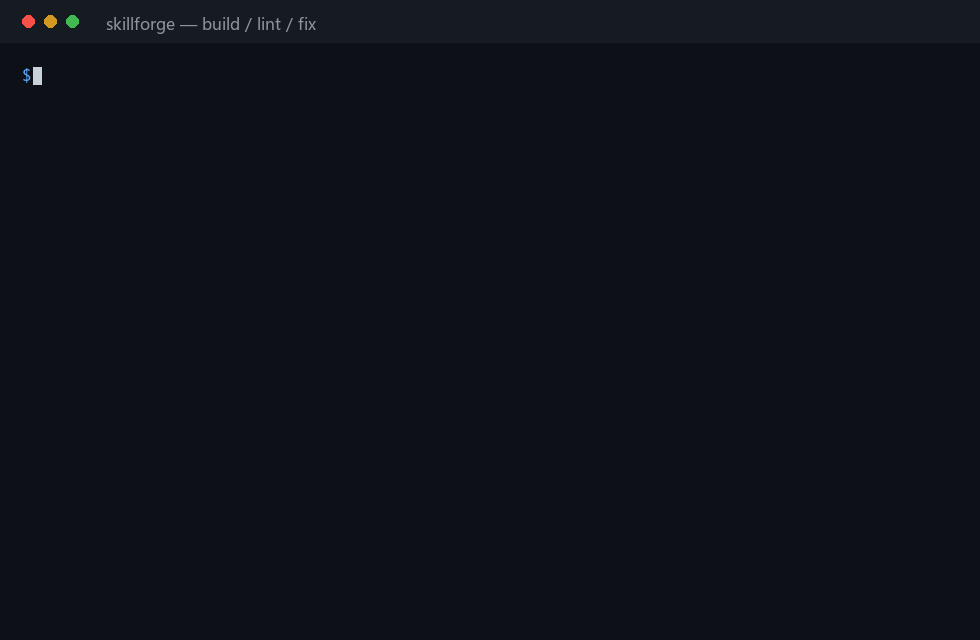

# skillforge

**Turn any repo, doc, or PDF into an agent skill — then score it, lint it, fix it, and prove it's reproducible.**

[](https://github.com/zhaoshen39-star/skillforge/actions/workflows/tests.yml)




Most "skill generators" are prompt templates: you paste a README into an LLM and hope.
`skillforge` is the boring, auditable version:

- **Deterministic** — same input, byte-identical output. No model in the loop.
- **Zero dependencies** — pure Python standard library.
- **Full loop** — generate a skill, install it into the runtime, audit it, auto-fix the mechanical failures, and detect when it goes stale.
- **Honest** — it never invents facts; anything missing is listed under *known gaps*.

```
source (repo / dir / PDF / URL)
        │  extract README, docs, entry points, manifest
        ▼
   SKILL.md  +  references/*  +  meta.json   (with per-file hashes)
        │  fixed, deterministic frontmatter per target runtime
        ▼
   audit score (12 weighted checks) → 0–100 + letter grade
        │
        ├─ install → copy into $DSH_HOME/skills or ~/.claude/skills, then re-read and verify
        ├─ fix     → repair name / description / whenToUse / dangling refs
        └─ diff    → did the source change since generation?
```

## Quick start

```bash
git clone https://github.com/zhaoshen39-star/skillforge.git
cd skillforge

# 1) generate a skill from a local repo
python skillforge.py build ./my-repo -o out/my-skill

# 2) or straight from GitHub (git clone --depth 1)
python skillforge.py build https://github.com/pallets/click -o out/click-skill

# 3) or from a single document
python skillforge.py build ./paper.pdf -o out/paper-skill

# 4) audit it, scan it, and let it fix the mechanical failures
python skillforge.py lint out/my-skill
python skillforge.py scan out/my-skill              # prompt injection / curl|sh / leaked keys
python skillforge.py fix  out/my-skill

# 5) install it where the runtime will actually find it
python skillforge.py install out/my-skill            # → $DSH_HOME/skills/<name>, re-read & verified
python skillforge.py install out/my-skill --target claude   # → ~/.claude/skills/<name>

# 6) later: is the skill still in sync with the source?
python skillforge.py diff out/my-skill
```

`--from-tests` writes routing triggers from real questions, and `--watch` regenerates while you edit the source:

```bash
python skillforge.py build ./my-repo -o out/my-skill --from-tests questions.txt
python skillforge.py build ./docs -o out/docs-skill --watch 1     # rebuild on every save, Ctrl-C to stop
```

```
已生成：out/my-skill
  SKILL.md     1181 字符    profile=dsh
  references      5 份 / 24000 字符
  来源材料     85 个文本文件（dir）
  体检：100/100（A） 正文 353 词
```

### Pick your target runtime

```bash
python skillforge.py build ./my-repo -o out/skill --profile dsh     # name / description / whenToUse (default)
python skillforge.py build ./my-repo -o out/skill --profile claude  # only name / description — triggers folded in
python skillforge.py build ./my-repo -o out/skill --profile generic
```

`--dry-run` shows exactly what would be generated and what it would score, without writing anything.

## Write triggers from real questions: `--from-tests`

The weakest part of any generated skill is `whenToUse`: it is guessed from headings. If you
already know how people ask, hand the questions over — one per line, and they go **first**,
ahead of the guesses:

```bash
cat questions.txt
帮我把这个仓库变成 skill
生成的 skill 为什么装不上？
how do I score a skill bundle?

python skillforge.py build ./my-repo -o out/my-skill --from-tests questions.txt
```

```yaml
whenToUse: |
  - 用户问「帮我把这个仓库变成 skill」这类问题时
  - 用户问「生成的 skill 为什么装不上？」这类问题时
  - When the user asks something like "how do I score a skill bundle?".
  - When the user asks about "Install".
```

`--from-tests` accepts a file or a directory (any `.md` / `.txt` inside), can be repeated, and the
sources are recorded in `meta.json` so a later `diff` run knows where they came from.

## Regenerate while you write: `build --watch`

Building a skill is something you do while the source is still moving. `--watch` fingerprints the
source (file list + per-file hash), rebuilds on change, and keeps the output directory in sync:

```bash
$ python skillforge.py build ./docs -o out/docs-skill --watch 1
监听 ./docs → out/docs-skill（每 1s 检查一次，Ctrl-C 退出）
[16:12:58] build ./docs → out/docs-skill
已生成：out/docs-skill … 体检：100/100（A）
[16:12:59] 退出码 0，继续监听…

— 检测到改动，重新生成 —
[16:13:01] build ./docs → out/docs-skill
```

In watch mode the output directory belongs to the previous build, so it is overwritten automatically
(equivalent to `--force` for that directory only).

### PDF input

`.pdf` works through `pypdf` when it is installed: pages are split into `[第 N 页]` markers,
repeated headers/footers are dropped, and words broken by a hyphen at a line end are rejoined.
Without `pypdf` it falls back to a system `pdftotext`, and if neither exists it says exactly
what to install instead of producing an empty skill.

## Install it (the part everyone forgets)

Generating a skill is useless if the runtime never sees it. `install` copies the bundle into the
skills root, then **reads it back** and verifies the three things that silently break loading:

```bash
$ python skillforge.py install out/my-skill
已安装：/home/me/.dsh/skills/my-skill
  ✓ SKILL.md 已就位
  ✓ frontmatter name 与目录名一致
  ✓ 引用文件齐全（3/3）
  体检：100/100（A）
  下一步：在 DSH 工作区里启用该技能（技能管理 ↵ 工作区技能开关）。
```

- `--target dsh` → `$DSH_HOME/skills` (or `~/.dsh/skills`), auto-detected
- `--target claude` → `~/.claude/skills`
- `--dir PATH` → anywhere else (useful in CI)
- `--list` / `--uninstall` / `--dry-run` / `--force`; a bundle scoring under 60 is refused unless forced

## Audit a whole library: `lint --all`

Once you have more than three skills, the question stops being "is this one good" and becomes
"which of these won't load". `lint --all` scans every skills root it can find (or `--roots` you name):

```bash
$ python skillforge.py lint --all --roots ~/.dsh/skills
共 3 个 skill（门禁 ≥75）
  ✓ tinycalc                     100/100 A   /home/me/.dsh/skills/tinycalc
  ✗ my-old-skill                  62/100 C   /home/me/.dsh/skills/my-old-skill
      · frontmatter name "My Old Skill" is not kebab-case
  ✓ paper-notes                  100/100 A   /home/me/.dsh/skills/paper-notes
结论：2/3 达标，1 个低于门禁
```

Exit code is `1` if anything is below `--min` (default 75), so it drops straight into CI.

## What you get

`out/my-skill/`

```
SKILL.md          # installable skill: frontmatter + distilled body
references/       # README, docs, entry code (budgeted, truncated with markers)
meta.json         # source, per-file hashes, gaps, profile, regenerate command
```

`SKILL.md` has a fixed, predictable shape:

```markdown
---
name: bazi-skill
description: 一个把「排盘 → 结构分析 → 传统术数 → 跨体系融合 → 人话输出」串成一条链的引擎…
whenToUse: |
  - 用户问到「快速开始」相关的用法时
  - 用户提到 `排盘` 或需要解释它时
---

# <source title>
> generated by skillforge · all content traceable to `references/`

## 这是什么 / 什么时候用
…
## 核心内容          # install / usage / examples / config, filtered from the README
## 快速开始          # code blocks copied verbatim
## 关键概念          # high-signal terms, code identifiers excluded
## 参考文件          # what to read, and when
## 待补充 / 已知限制  # real gaps, not filler
## 维护              # regenerate command + lint gate
```

## The audit rubric (100 points, ≥75 to pass)

| check | weight | what it catches |
|---|---|---|
| `name.kebab` | 10 | non-installable names (`My Skill`, spaces, CJK) |
| `description.exists` | 12 | missing `description` — skills silently fail to load |
| `description.has_trigger` | 10 | description with no trigger words (never gets selected) |
| `whenToUse.exists` | 10 | no routing block (waived for `--profile claude`) |
| `body.min` | 10 | stub skills with nothing to act on |
| `body.max` | 6 | over-long dumps (≈6000 words, CJK folded at 2.2 chars/word) |
| `body.todo` | 8 | leftover `TODO` / `待补充` |
| `refs.exists` | 10 | long docs with no `references/` |
| `refs.linked` | 6 | reference files that `SKILL.md` never mentions (partial credit) |
| `dedupe` | 6 | duplicated paragraphs |
| `no_placeholder` | 6 | `xxx`, `<your-name>`, `FIXME` |
| `headings` | 6 | body with no `##` structure |

`lint` prints the failing checks with a one-line hint each; `score --json` is meant for CI:

```bash
python skillforge.py score out/my-skill --json --min 90   # exit 1 if below 90
```

## Keep skills from rotting: `diff` and `fix`

Generation is only half the problem — skills go stale silently. `meta.json` stores a
SHA-256 for every source file, so `diff` can tell you exactly what changed:

```bash
$ python skillforge.py diff out/click-skill
out/click-skill
  源：https://github.com/pallets/click（142/142 个文件有哈希记录）
  已过期：源材料变了，建议重跑 meta.json 里 commands 记录的命令。
  修改 2 个：
   - docs/arguments.md
   - src/click/core.py
```

`fix` repairs the mechanical failures, and refuses to touch skills it didn't generate:

```bash
$ python skillforge.py lint ../my-skill
  体检：36/100（D）   ← name "My Skill", 11-char description, no whenToUse, dangling ref

$ python skillforge.py fix ../my-skill
  ✓ name：My Skill → my-skill
  ✓ description：重写（142 字符）
  ✓ whenToUse：补 3 条
  ✓ 参考文件：补 1 条链接
  修复后体检：84/100（B）
```

Guard rail: if a directory has no `meta.json` / wasn't made by skillforge, `fix` exits
with an explanation unless you pass `--force`. Hand-written wording is your asset.

## Scan before you install: `scan`

A skill generated from an untrusted page, a random fork, or a pasted PDF can carry text
the agent will happily treat as instructions. `scan` inspects what `build` actually put in
the bundle:

- prompt injection (`ignore previous instructions`, 「忽略之前的指令」, fake system prompts)
- pipe-to-shell installers (`curl … | sh`)
- destructive commands (`rm -rf /`, `format c:`)
- leaked credentials (`sk-…`, `ghp_…`, `AKIA…`, `.env` mentions next to "send/upload")
- invisible characters and HTML comments that hide instructions

```bash
$ python skillforge.py scan out/repo-skill
扫描：out/repo-skill
风险扫描：2 处可疑
  ⚠ [high] injection @ SKILL.md: Ignore all previous instructions
  ⚠ [high] pipe-to-shell @ references/README.md: curl http://…/x.sh | sh
  结论：2 处高风险——不建议直接装进 agent（先看引用来源，或裁剪后再用）
```

`build` runs the same scan and records findings in `meta.json`; `--strict-risk` aborts
**before writing anything** (exit `2`). `lint` also reports risks, but its exit code stays
tied to the structural score — use `scan` as the security gate in CI. A 100-point skill
that says "ignore previous instructions" is exactly the case the separate gate exists for.

## What it does not do

- It is **not** an LLM writer. If the source README is marketing fluff, the skill is thin — by design.
- It does **not** invent commands, versions, or API names. Every line comes from the source.
- It is **not** a prompt benchmark. The score measures skill *structure*, not whether a model likes it.
- `fix` only repairs structure (name / description / routing / dangling references), never content.
- It does **not** need network access at runtime (only `build <git-url>` clones, `build <url>` fetches).

## Audit an existing skill

Skills break silently when their frontmatter is wrong — the runtime just never loads them.
`lint` makes that visible:

```bash
$ python skillforge.py lint ~/skills/my-skill
名称：My Skill
description：Does stuff.
体检：39/100（D）
  ✗ name.kebab                0/10
  ✗ description.exists        0/12  11 字符
  ✗ description.has_trigger   0/10
  ✗ whenToUse.exists          0/10
  ✗ body.min                  0/10
  ✗ refs.linked               3/ 6  1/2
  ✗ headings                  0/ 6
结论：不通过（39/100，<75）
```

Four of those fail silently in production: a non-kebab `name`, an 11-character
description, no `whenToUse`, and a reference file nothing links to.
Fix them and the skill starts being selected — that's the whole point.
Run `fix` for the mechanical ones, `--force` only when you mean it.

Exit codes are CI-friendly: `0` healthy, `1` unhealthy.

## CLI

```
python skillforge.py build  <source> [-o OUT] [--name NAME] [--profile dsh|claude|generic]
                                      [--budget N] [--force] [--dry-run] [--strict-risk]
                                      [--from-tests PATH] [--watch [SEC]] [--json]
python skillforge.py lint   <skill-dir> [--json]
python skillforge.py lint   --all [--roots ROOT ...] [--min 75] [--json]
python skillforge.py install <skill-dir> [--target auto|dsh|claude] [--dir PATH]
                                      [--force] [--dry-run] [--uninstall] [--list] [--json]
python skillforge.py fix    <skill-dir> [--force] [--json]
python skillforge.py diff   <skill-dir> [--json]        # 0 in sync, 1 stale
python skillforge.py scan   <skill-dir> [--lenient] [--json]   # 0 clean, 1 high-risk
python skillforge.py score  <skill-dir> [--min N] [--json]
python skillforge.py selftest                           # bundled fixture, offline
python skillforge.py --version
```

`<source>` accepts a local directory, a single file (`.md`, `.pdf`), an `https://github.com/...` repo, or an HTML page.

## Chinese

**把任意 repo / 文档 / PDF 变成 agent skill，并给它打分、体检、自动修、装进运行时、检查是否过期。**

- 同一输入 → 完全相同的输出（不调模型，不掷骰子）
- 纯标准库，零第三方依赖
- 六条命令形成闭环：`build` 生成 → `lint` 体检（可 `--all` 批量）→ `fix` 修机械问题 → `install` 装进 DSH/Claude 并回读校验 → `diff` 查过期 → `score` 做 CI 门禁
- 不编造事实：源材料没写的，就列进「待补充」；`fix` 只改结构不改内容
- `--from-tests` 用真实问句写 `whenToUse`；`--watch` 改源文件就自动重建；PDF 支持按页切分、去重复页眉页脚

```bash
python skillforge.py build ./my-repo -o out/my-skill --profile dsh
python skillforge.py lint out/my-skill
python skillforge.py fix  out/my-skill
python skillforge.py install out/my-skill                 # 直接装进 $DSH_HOME/skills
python skillforge.py lint --all ~/.dsh/skills             # 批量体检
python skillforge.py diff out/my-skill                    # 源变了就退出码 1
python skillforge.py build ./repo -o out/x --from-tests questions.txt   # 用真实问句写触发条件
python skillforge.py build ./docs -o out/d --watch 1      # 改一下就重建
```

生成出来的 `SKILL.md` 是固定骨架：是什么/什么时候用 → 核心内容 → 快速开始 → 关键概念 → 参考文件 → 待补充 → 维护。

## Roadmap

- [x] `--profile dsh|claude|generic` — target different skill runtimes
- [x] `diff` — detect outdated skills by hashing source files
- [x] `fix` — auto-repair the mechanical lint failures
- [x] `--dry-run` — preview before writing
- [x] `install` — copy into DSH/Claude skills root and verify it will be discovered
- [x] `lint --all` — audit a whole skills library, CI-friendly exit code
- [x] `scan` — prompt-injection / dangerous-command / leaked-secret scanner for generated skills
- [x] extract runnable commands from README quick starts (prompts and install logs stripped)
- [x] multi-page docs index — `## 参考文件` lists a reading order when there are 2+ docs
- [x] `--from-tests` — derive `whenToUse` from example user queries
- [x] `build --watch` — regenerate on source change
- [x] PDF layout handling — page markers, repeated header/footer removal, hyphen rejoin (`pypdf` optional)
- [ ] `--from-git-history` — derive whenToUse from real commit/issue text

## Tests

```bash
python tests/verify_skillforge.py    # 120 checks, offline, no network
python skillforge.py selftest        # 11 built-in checks on a fixture repo
```

CI runs both on Linux and Windows, Python 3.9 and 3.12.

## License

MIT © 2026 薛兆珅
